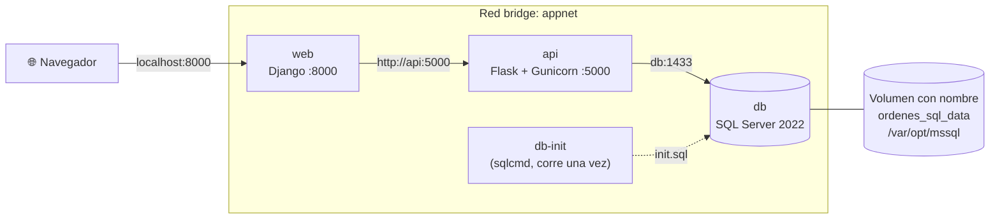

# 🛒 Sistema de Órdenes de Venta — Arquitectura de 3 contenedores

Examen práctico del segundo parcial — **Arquitectura de Computadoras**.

Aplicación de órdenes de venta distribuida en tres contenedores orquestados con Docker Compose:
**SQL Server 2022** (datos) · **API REST en Flask** (servicios) · **Frontend en Django** (presentación).

## 👥 Integrantes

| Nombre completo | Número de cuenta |
|---|---|
| Astrid Lizbeth Castellanos Pineda | 202410010300 |
| Gustavo Adolfo Siu Marquez | 200710510076 |

## 🏗️ Arquitectura



| Servicio | Tecnología | Puerto | Responsabilidad |
|---|---|---|---|
| `db` | SQL Server 2022 (imagen oficial) | 1433 (solo red interna) | Base `OrdenesDB` con `ordenes` y `orden_detalle`; datos en volumen `ordenes_sql_data` |
| `db-init` | Imagen de SQL Server + `sqlcmd` | — | Ejecuta `db/init.sql` y termina |
| `api` | Python + Flask (imagen propia) | 5000 | CRUD REST en JSON; **único** servicio que habla con la BD |
| `web` | Python + Django (imagen propia) | 8000 | Pantallas CRUD; consume la API con `requests` |

Flujo: **Navegador → web (Django) → api (Flask) → db (SQL Server)**.

### Estructura del repositorio

```
examen-Infra/
├── compose.yaml        # db, db-init, api, web + red + volumen + healthchecks + límites
├── .env.example        # plantilla de variables (sin contraseñas reales)
├── db/init.sql         # BD, tablas, FK y 5 órdenes de prueba (idempotente)
├── api/                # Dockerfile, .dockerignore, requirements.txt, app.py
├── web/                # Dockerfile, .dockerignore, requirements.txt, proyecto Django
└── evidencias/         # capturas de funcionamiento
```

## ⚙️ Requisitos

- Docker 24+ y Docker Compose v2
- Puertos `8000` y `5000` libres
- ~2 GB de RAM libres para SQL Server

## 🚀 Ejecución desde cero

```bash
# 1. Clonar
git clone https://github.com/<usuario>/examen-Infra.git
cd examen-Infra

# 2. Variables de entorno (edita MSSQL_SA_PASSWORD y DOCKERHUB_USER)
cp .env.example .env

# 3. Construir y levantar los tres servicios
docker compose up -d --build

# 4. Verificar (db, api y web deben quedar "healthy")
docker compose ps
```

| Servicio | URL |
|---|---|
| Frontend | http://localhost:8000 |
| API health | http://localhost:5000/health |
| API órdenes | http://localhost:5000/api/ordenes |

> La contraseña de SQL Server (`MSSQL_SA_PASSWORD`) solo vive en `.env` (ignorado por git). Debe tener 8+ caracteres con mayúscula, minúscula y número, y **sin el símbolo `$`**.

### ¿Cómo se ejecuta `init.sql`?

El servicio **`db-init`** espera a que `db` esté sano (`service_healthy`), ejecuta `db/init.sql` con `sqlcmd` y termina. Solo después arranca la API (`service_completed_successfully`). El script es **idempotente**: crea la BD y las tablas solo si no existen e inserta los datos de prueba solo si `ordenes` está vacía, por lo que **no borra datos** al reiniciar. Para volver a ejecutarlo manualmente:

```bash
docker compose run --rm db-init
```

## 🗄️ Modelo de datos (`OrdenesDB`)

- **ordenes**: `id` (PK, IDENTITY), `cliente`, `fecha`, `estado` (`Pendiente` | `Pagada` | `Anulada`), `total`
- **orden_detalle**: `id` (PK, IDENTITY), `orden_id` (FK → `ordenes.id`, `ON DELETE CASCADE`), `producto`, `cantidad`, `precio_unitario`, `subtotal` (= cantidad × precio_unitario)

El `total` de la orden se **recalcula** cada vez que se agrega, modifica o elimina un detalle.

## 🔌 Endpoints de la API

Respuestas en JSON con códigos `200`, `201`, `400` (datos inválidos) y `404` (no existe).

| Método | Ruta | Acción |
|---|---|---|
| GET | `/api/ordenes` | Listar órdenes |
| GET | `/api/ordenes/<id>` | Ver una orden con sus detalles |
| POST | `/api/ordenes` | Crear orden (`cliente`, `estado` opcional) |
| PUT | `/api/ordenes/<id>` | Actualizar orden (`cliente` y/o `estado`) |
| DELETE | `/api/ordenes/<id>` | Eliminar orden y sus detalles |
| GET / POST | `/api/ordenes/<id>/detalles` | Listar / agregar líneas de detalle |
| PUT / DELETE | `/api/detalles/<id>` | Actualizar / eliminar una línea |
| GET | `/health` | Estado de la API y de la conexión a la BD |

### Pruebas con curl

```bash
curl http://localhost:5000/health
curl http://localhost:5000/api/ordenes
curl http://localhost:5000/api/ordenes/1

curl -X POST http://localhost:5000/api/ordenes \
  -H "Content-Type: application/json" \
  -d '{"cliente":"Juan Perez","estado":"Pendiente"}'

curl -X POST http://localhost:5000/api/ordenes/1/detalles \
  -H "Content-Type: application/json" \
  -d '{"producto":"Laptop","cantidad":2,"precio_unitario":800}'

curl -X PUT http://localhost:5000/api/ordenes/1 \
  -H "Content-Type: application/json" -d '{"estado":"Pagada"}'

curl -X DELETE http://localhost:5000/api/detalles/1
curl -X DELETE http://localhost:5000/api/ordenes/1

# Errores esperados
curl -i http://localhost:5000/api/ordenes/9999                                  # 404
curl -i -X POST http://localhost:5000/api/ordenes -H "Content-Type: application/json" -d '{}'   # 400
```

## 🧱 Buenas prácticas aplicadas

- Dockerfiles propios con `FROM`, `WORKDIR`, `COPY`, `RUN`, `EXPOSE`, `CMD`; `requirements.txt` primero para aprovechar la caché de capas.
- Usuario sin privilegios (`USER appuser` / `USER webuser`) en `api` y `web`.
- `.dockerignore` en `api/` y `web/`.
- `healthcheck` en los tres servicios; `depends_on` con `condition: service_healthy` (api → db, web → api).
- Red bridge propia (`appnet`) y volumen con nombre (`ordenes_sql_data`).
- Límites de recursos: `db` 1 CPU / 2 GB · `api` 0.5 CPU / 512 MB · `web` 0.5 CPU / 512 MB.
- Secretos en `.env` (no versionado); `.env.example` sin contraseñas reales.

## 🐳 Imágenes en Docker Hub

- API: `https://hub.docker.com/r/<usuario>/ordenes-api` → `<usuario>/ordenes-api:v1.0`
- Web: `https://hub.docker.com/r/<usuario>/ordenes-web` → `<usuario>/ordenes-web:v1.0`

Publicación (con `DOCKERHUB_USER=<usuario>` en `.env`, las imágenes ya quedan con ese nombre):

```bash
docker login
docker compose build
docker push <usuario>/ordenes-api:v1.0
docker push <usuario>/ordenes-web:v1.0
```

## 📸 Evidencias (carpeta `evidencias/`)

| Archivo | Descripción |
|---|---|
| `compose_ps.png` | `docker compose ps` con los tres servicios sanos |
| `crud_web.png` | CRUD funcionando en el navegador |
| `api_curl.png` | Pruebas de la API (curl / Postman) |
| `persistencia.png` | Datos que persisten tras `docker compose down` y `up` |
| `docker_stats.png` | `docker stats` con los límites de memoria/CPU |

Prueba de persistencia:

```bash
docker compose down          # conserva el volumen
docker compose up -d
curl http://localhost:5000/api/ordenes   # los datos siguen ahí
docker compose down -v       # ⚠️ borra el volumen (reinicia desde cero)
```

## 🧪 Comandos útiles

```bash
docker compose logs -f api
docker compose logs -f web
docker compose logs db-init
docker stats --no-stream
```
