# 🛒 Sistema de Órdenes de Venta

Proyecto del examen práctico del segundo parcial de **Arquitectura de Computadoras**.

Es una aplicación sencilla para registrar órdenes de venta y los productos que lleva cada una. Está dividida en tres contenedores de Docker que se levantan juntos con un solo comando: la base de datos (SQL Server), una API hecha con Flask y la página web hecha con Django.

La idea es que la página web nunca toca la base de datos directamente: le pide todo a la API, y la API es la única que habla con SQL Server.

## 👥 Integrantes

| Nombre completo | Número de cuenta |
|---|---|
| Astrid Lizbeth Castellanos Pineda | 202410010300 |
| Gustavo Adolfo Siu Marquez | 200710510076 |

## 🏗️ Cómo está armado

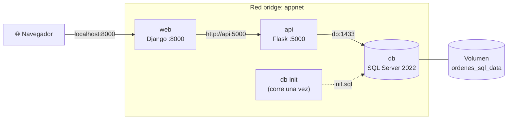

El recorrido es: **Navegador → web (Django) → api (Flask) → db (SQL Server)**.

| Servicio | Qué usa | Puerto | Para qué sirve |
|---|---|---|---|
| `db` | SQL Server 2022 (imagen oficial) | 1433 (solo dentro de la red) | Guarda la base `OrdenesDB`. Los datos quedan en un volumen para que no se pierdan |
| `db-init` | La misma imagen de SQL Server | — | Crea las tablas y carga los datos de prueba. Corre una vez y se apaga |
| `api` | Python + Flask | 5000 | Recibe las peticiones, hace el CRUD y responde en JSON |
| `web` | Python + Django | 8000 | Las pantallas que ve el usuario. Todo lo consulta a la API |

### Carpetas del proyecto

```
examen-ordenes-docker/
├── compose.yaml        # define los servicios, la red, el volumen y los límites
├── .env.example        # plantilla de variables (sin contraseñas reales)
├── db/init.sql         # tablas y datos de prueba
├── api/                # Dockerfile, requirements.txt y app.py
├── web/                # Dockerfile, requirements.txt y el proyecto Django
└── evidencias/         # capturas de que todo funciona
```

## ⚙️ Qué necesitas

- Docker con Docker Compose v2
- Los puertos `8000` y `5000` libres
- Unos 2 GB de RAM disponibles para Docker, porque SQL Server consume bastante

## 🚀 Cómo correrlo

```bash
# 1. Descargar el proyecto
git clone https://github.com/astridcast10/examen-ordenes-docker.git
cd examen-ordenes-docker

# 2. Crear el archivo de variables
cp .env.example .env

# 3. Levantar todo
docker compose up -d --build

# 4. Revisar que todo esté bien
docker compose ps
```

Antes del paso 3, abre el `.env` y cambia `MSSQL_SA_PASSWORD` por una contraseña tuya. SQL Server pide que tenga **mínimo 8 caracteres, con mayúscula, minúscula y número**. Mejor no usar el símbolo `$`, porque Docker Compose lo confunde con una variable. En `DOCKERHUB_USER` pon tu usuario de Docker Hub.

La primera vez puede tardar uno o dos minutos, porque SQL Server demora en arrancar y la API y la web esperan a que esté listo. Es normal. Cuando `db`, `api` y `web` aparezcan como `healthy`, ya se puede usar.

| Qué | Dónde |
|---|---|
| La página web | http://localhost:8000 |
| Estado de la API | http://localhost:5000/health |
| Lista de órdenes (API) | http://localhost:5000/api/ordenes |

### ¿Cómo se carga el `init.sql`?

Lo hace el servicio `db-init`. Espera a que la base de datos esté lista, ejecuta `db/init.sql` con `sqlcmd` y se apaga. Solo después arranca la API.

Lo hicimos de forma que se pueda ejecutar varias veces sin problema: si las tablas ya existen no las toca, y los datos de prueba solo se agregan si todavía no están. Así no se borra nada cuando se reinicia el proyecto. Si por algo quieren volver a correrlo a mano:

```bash
docker compose run --rm db-init
```

## 🗄️ Los datos

La base se llama `OrdenesDB` y tiene dos tablas:

- **ordenes**: `id`, `cliente`, `fecha`, `estado` (Pendiente, Pagada o Anulada) y `total`.
- **orden_detalle**: `id`, `orden_id` (llave foránea hacia `ordenes`), `producto`, `cantidad`, `precio_unitario` y `subtotal`.

El `total` de cada orden se actualiza solo cada vez que se agrega, cambia o elimina un producto. Si se elimina una orden, también se eliminan sus productos.

Al iniciar hay 9 órdenes de prueba, cada una con 2 o 3 productos.

## 🔌 La API

Responde siempre en JSON. Usa `200` cuando todo sale bien, `201` cuando crea algo, `400` si los datos que se enviaron están mal y `404` si lo que se busca no existe.

| Método | Ruta | Qué hace |
|---|---|---|
| GET | `/api/ordenes` | Lista todas las órdenes |
| GET | `/api/ordenes/<id>` | Muestra una orden con sus productos |
| POST | `/api/ordenes` | Crea una orden (`cliente` y, si quieren, `estado`) |
| PUT | `/api/ordenes/<id>` | Cambia el `cliente` y/o el `estado` |
| DELETE | `/api/ordenes/<id>` | Elimina la orden y sus productos |
| GET / POST | `/api/ordenes/<id>/detalles` | Lista o agrega productos a una orden |
| PUT / DELETE | `/api/detalles/<id>` | Edita o elimina un producto |
| GET | `/health` | Dice si la API y la base de datos están funcionando |

### Ejemplos con curl

```bash
curl http://localhost:5000/health
curl http://localhost:5000/api/ordenes
curl http://localhost:5000/api/ordenes/1

# Crear una orden
curl -X POST http://localhost:5000/api/ordenes \
  -H "Content-Type: application/json" \
  -d '{"cliente":"Juan Perez","estado":"Pendiente"}'

# Agregar un producto a la orden 1
curl -X POST http://localhost:5000/api/ordenes/1/detalles \
  -H "Content-Type: application/json" \
  -d '{"producto":"Laptop","cantidad":2,"precio_unitario":800}'

# Cambiar el estado
curl -X PUT http://localhost:5000/api/ordenes/1 \
  -H "Content-Type: application/json" -d '{"estado":"Pagada"}'

# Eliminar
curl -X DELETE http://localhost:5000/api/detalles/1
curl -X DELETE http://localhost:5000/api/ordenes/1
```

Para ver los errores, prueben con una orden que no existe (`/api/ordenes/9999` da 404) o creen una orden sin cliente (da 400).

## 🧱 Lo que tuvimos en cuenta

- Las imágenes de `api` y `web` las armamos con nuestros propios Dockerfile, copiando primero el `requirements.txt` para que Docker reutilice las capas y los builds sean más rápidos.
- Las dos corren con un usuario normal, no con root.
- Cada una tiene su `.dockerignore`.
- Los tres servicios tienen `healthcheck`, y cada uno espera a que el anterior esté sano antes de arrancar (la API espera a la base de datos y la web espera a la API).
- Usamos una red propia (`appnet`) y un volumen con nombre (`ordenes_sql_data`).
- Cada servicio tiene límite de recursos: `db` 1 CPU y 2 GB, `api` y `web` 0.5 CPU y 512 MB.
- La contraseña vive solo en el `.env`, que no se sube a GitHub. En el repo solo está el `.env.example`.

## 🐳 Imágenes en Docker Hub

- API: https://hub.docker.com/r/astridcast10/ordenes-api → `astridcast10/ordenes-api:v1.0`
- Web: https://hub.docker.com/r/astridcast10/ordenes-web → `astridcast10/ordenes-web:v1.0`

Para publicarlas:

```bash
docker login
docker push astridcast10/ordenes-api:v1.0
docker push astridcast10/ordenes-web:v1.0
```

## 📸 Evidencias

### 1. Los tres servicios funcionando
`db`, `api` y `web` aparecen como `healthy`, y `db-init` terminó con `Exited (0)`, que es lo esperado.

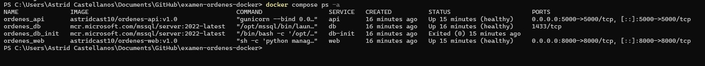

### 2. La página web con el CRUD completo (http://localhost:8000)

| Lista | Crear | Agregar producto |
|---|---|---|
| 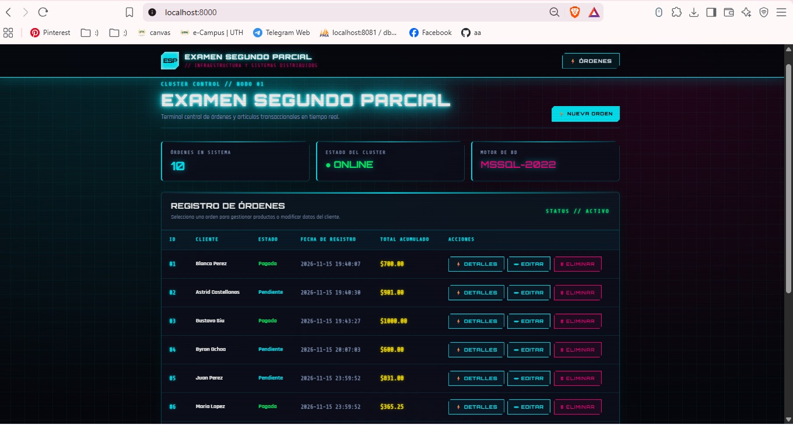 | 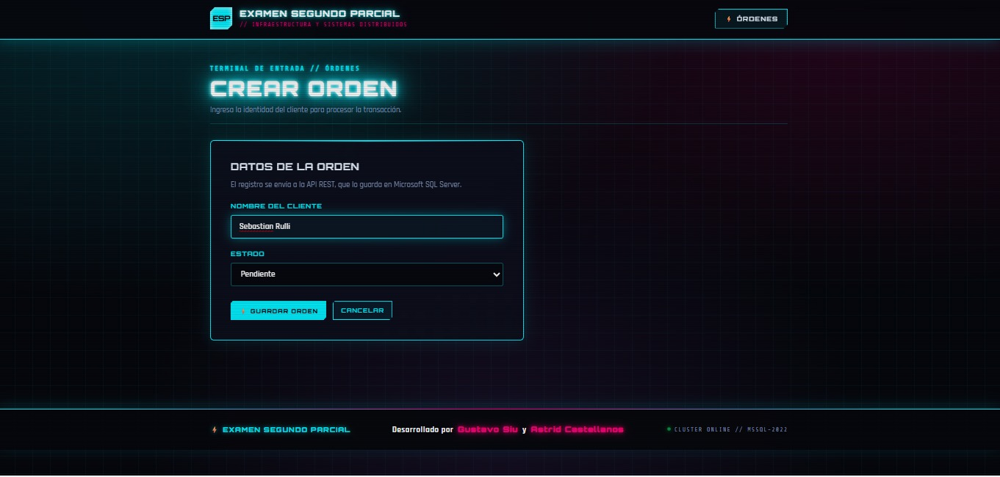 | 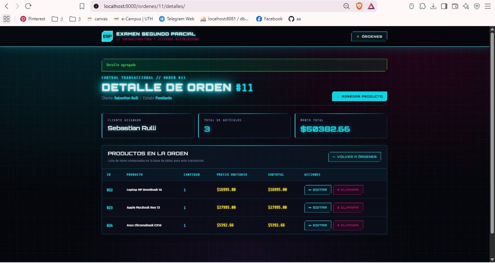 |

| Editar | Ya editado | Eliminar | Mensaje de error |
|---|---|---|---|
| 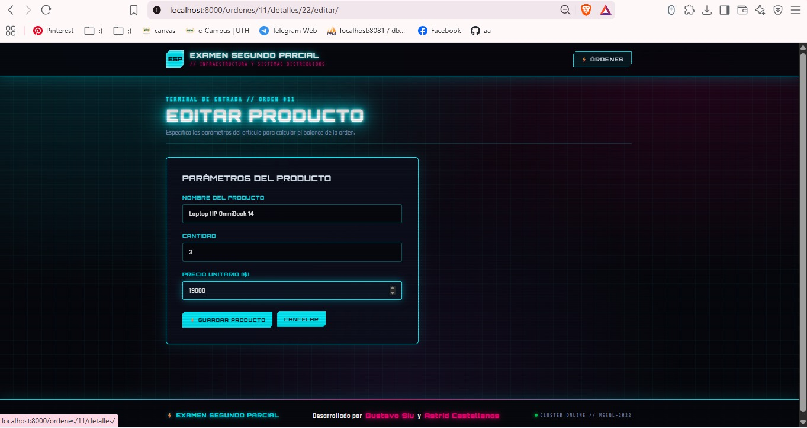 | 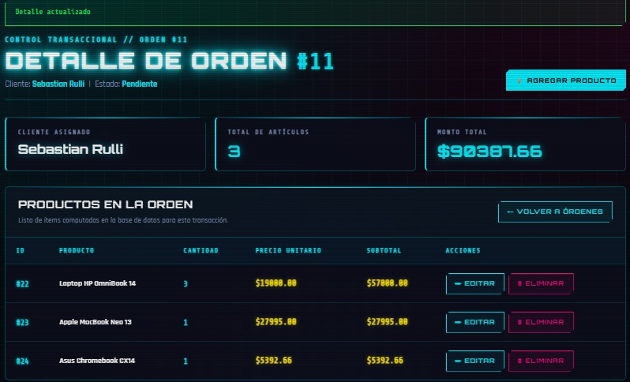 | 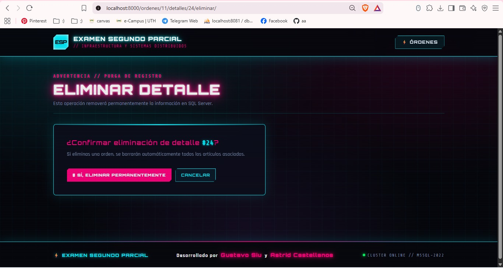 | 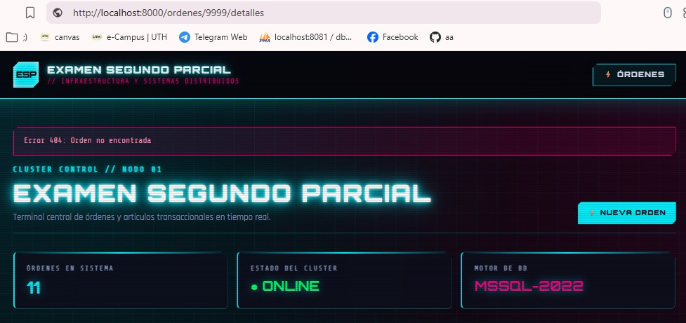 |

### 3. Pruebas de la API con curl
Consultas, el estado de la API y un 404:

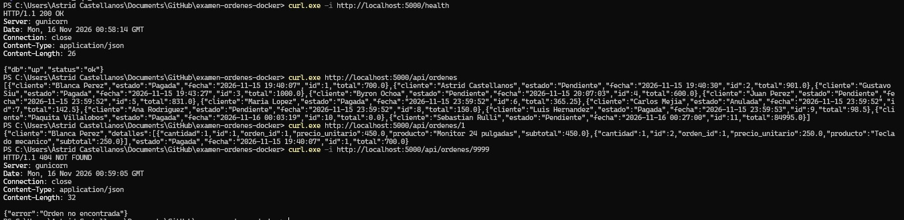

Actualizar, un error 400, eliminar y comprobar que luego da 404:

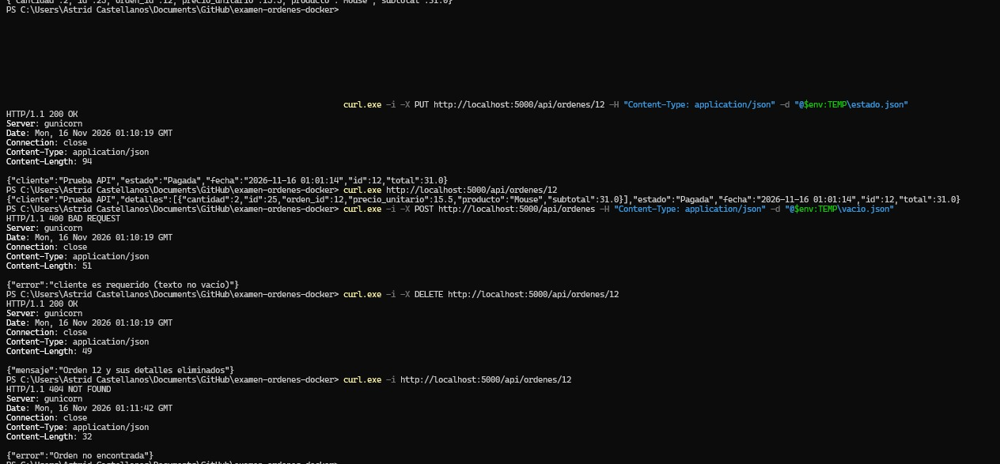

Las órdenes en formato de tabla:

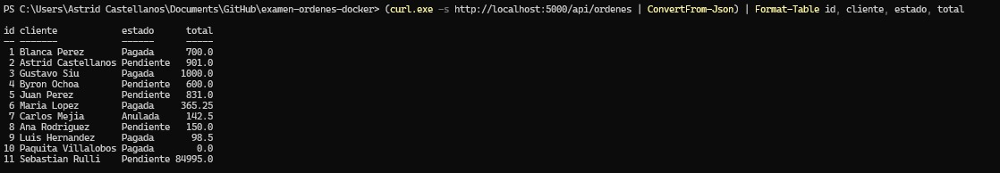

### 4. Los datos siguen ahí después de apagar y volver a encender
Consultamos la orden 11, apagamos todo con `docker compose down` (sin borrar el volumen), lo volvimos a levantar y la orden seguía igual.

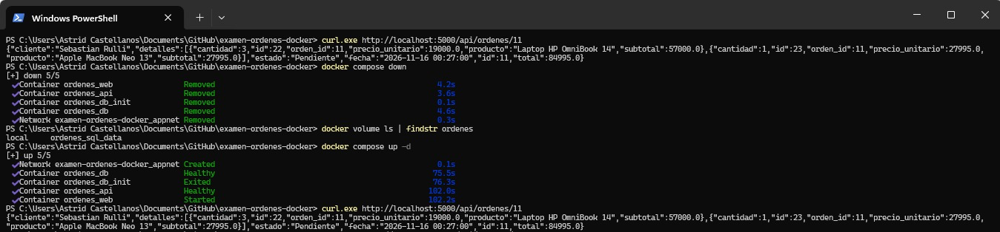

### 5. Límites de recursos
El uso de memoria con `docker stats` y los límites de CPU y memoria con `docker inspect`:

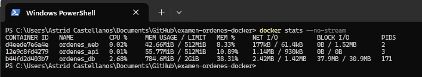

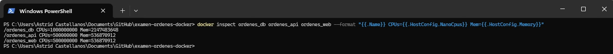

### 6. Imágenes publicadas en Docker Hub

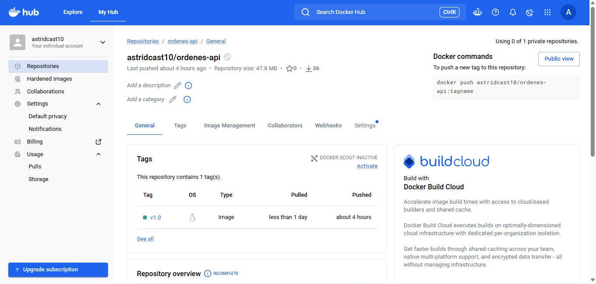

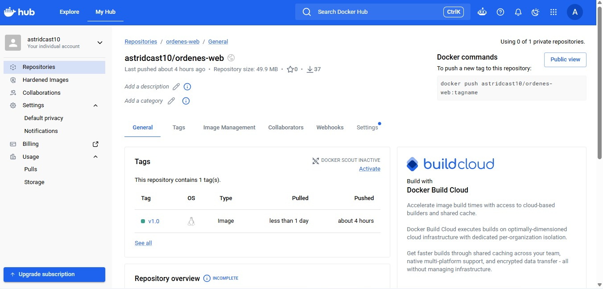

## 🖥️ Si usas Windows o Linux

- Para crear el `.env`: en Linux es `cp .env.example .env` y en Windows (PowerShell) es `copy .env.example .env`.
- En PowerShell usen `curl.exe` en lugar de `curl`, y para enviar JSON es más fácil guardarlo en un archivo y usar `-d "@archivo.json"`, porque con las comillas se complica.
- En Windows, Docker Desktop tiene que tener al menos 2 GB de memoria disponibles. Si SQL Server no arranca, casi siempre es por falta de memoria.

## 🧪 Comandos útiles

```bash
docker compose logs -f api      # ver lo que hace la API
docker compose logs -f web      # ver lo que hace la web
docker compose logs db-init     # revisar la carga inicial de la base
docker stats --no-stream        # uso de recursos

docker compose down             # apagar todo (los datos se conservan)
docker compose down -v          # apagar y borrar también los datos
```
